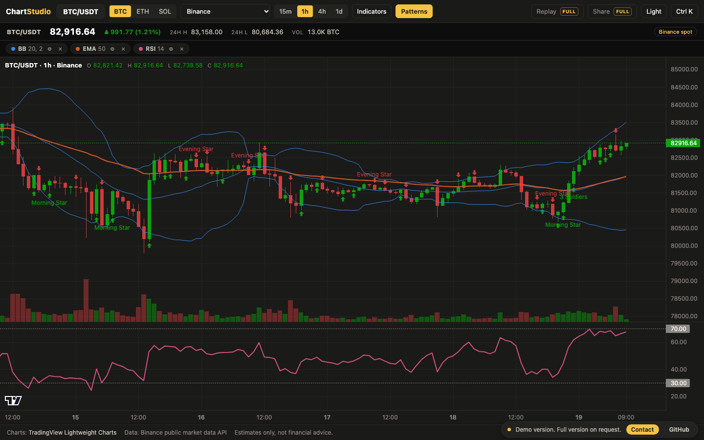

# Chart Studio

A browser trading chart studio that streams candles from six public crypto exchanges, layers technical indicators and candlestick pattern detection on top, and runs entirely in the browser.

**Live demo: https://artinbahmani.artin-bahmani0.workers.dev/chart-studio/**

The live demo is a limited preview: Binance only, three symbols (BTC, ETH, SOL), six indicators and pattern markers. Bar replay, shareable chart links, the other exchanges and the full indicator library are part of the full version.

## What it does

- **Six exchange datafeeds behind one interface.** Binance, Bybit, OKX, Kraken, Coinbase and Hyperliquid, all keyless. The chart never needs to know which venue it is on, and timeframes a venue does not serve are disabled instead of failing.
- **Indicator library of 46 studies.** Moving averages, bands and channels, trend, oscillator, volatility and volume studies. Overlays draw on the price pane, oscillators get their own pane, and every study has editable parameters and a live legend readout.
- **Candlestick pattern markers.** Fifteen classic patterns, including engulfing, harami, hammer, shooting star, morning and evening star, three white soldiers and three black crows, are detected from the bar data and marked on the chart.
- **Bar replay.** Step or play the chart forward bar by bar to study how a setup formed, with every indicator recomputed at each step.
- **Shareable chart state.** Symbol, exchange, timeframe, theme and indicator settings travel in one link, so a colleague opens exactly the same chart.
- **Command palette, themes and resilient loading.** Ctrl or Cmd plus K jumps to any symbol, timeframe, indicator or action. Light and dark themes, and clear loading, empty and error states with retry on every data path.

## How it works

Chart Studio is a static web app with no backend and no API keys. A datafeed layer holds one adapter per exchange; each adapter calls that exchange's public market data endpoint and normalizes the response into one common bar format, which smooths over the differences in field order, sort order, time units and bar limits between venues. An indicator engine of pure functions turns those bars into aligned series, and a registry describes each study (parameters, plots, pane, reference levels) so new indicators plug in without touching the user interface. The same bars feed the pattern detector. Rendering is handled by TradingView Lightweight Charts, with the app managing panes, markers, legends and state on top.

## Stack

- Vanilla JavaScript, HTML and CSS, no framework and no build step required
- TradingView Lightweight Charts v5 for rendering
- Public REST market data from Binance, Bybit, OKX, Kraken, Coinbase Exchange and Hyperliquid
- Runs on any static host

Market data is provided for information only and is not financial advice. Charts by [TradingView Lightweight Charts](https://www.tradingview.com/lightweight-charts/).

## Get the full version

Source code is private. To use it in your business or get the full version, contact me: artin.bahmani0@gmail.com

All rights reserved.
